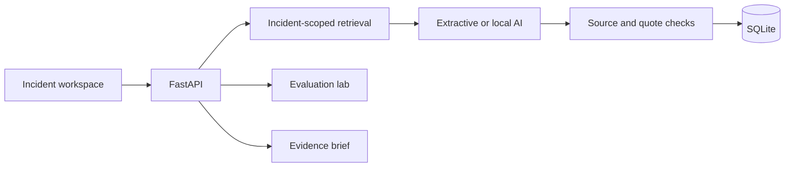

# Proofline

**Investigate an incident. Keep the evidence attached.**

Proofline is a local incident investigation workspace for a fictional commerce operation. Explore service signals and a timeline, ask questions against incident-scoped evidence, inspect cited excerpts, save notes, and export a brief someone else can audit. Its evaluation lab makes retrieval failures and unsupported-answer behavior visible.

All scenarios are synthetic. The complete core workflow needs no API key, model, account, or cloud service. Optional local AI uses an installed Ollama model; the default evidence-extraction mode is deterministic and is labeled accordingly.

## Start the demo

Requires **Python 3.12+**, **uv**, and **Node.js 22+**. Dependency installation needs internet access; normal extractive use after setup does not.

```sh
git clone https://github.com/ripleyforge/proofline.git
cd proofline
bash scripts/setup.sh
python3 scripts/serve.py
```

Open **http://127.0.0.1:8100**. Stop with Ctrl+C. The repository is currently private. On macOS, after setup, `Proofline.command` is also a launcher.

Choose an incident, open a source, and try a suggested question. The [five-minute walkthrough](docs/DEMO.md) covers the whole product.

## What you can do

- Investigate three operational incidents through metrics, dependencies, changes, logs, and runbooks.
- Compare BM25 and focused retrieval, inspect the steps and timing, and follow each source link.
- Switch between exact evidence extracts and optional local model prose without hidden fallbacks.
- Test unsupported questions, known untrusted evidence and citation failures in the evaluation lab.
- Save incident-scoped notes, reopen persisted investigations, and export Markdown or JSON briefs.

Citation checks validate source identity, incident scope and exact quoted text. They do **not** prove that model prose follows from a quote or that a suspected cause is correct. The deterministic evaluation suite is not an LLM benchmark. See [evaluation design](docs/EVALUATION.md) and [security boundaries](docs/SECURITY.md).

## Optional local model

Use an already installed local Ollama model. Proofline does not pull models or contact a hosted model API. Start a separate cloud-disabled listener:

```sh
bash scripts/start-local-model.sh
```

Then in another terminal:

```sh
PROOFLINE_OLLAMA_MODEL=llama3.1:8b-instruct-q4_K_M python3 scripts/serve.py
```

Replace the model name with your installed local model if needed. `OLLAMA_HOST=127.0.0.1:11435 ollama list` lists this listener's models. The UI enables local AI only when the model is available. Slow or unavailable inference is reported explicitly. The documented model was already present on the development machine; no new model is bundled.

## Architecture

React + TypeScript / Vite provides the interface. FastAPI coordinates small retrieval, generation, validation and persistence components. SQLite stores investigations, notes and evaluation results. BM25 is the transparent baseline; focused retrieval adds a documented policy. No vector database or agent framework is needed for this corpus.



[Product requirements](docs/PRODUCT.md) · [Architecture](docs/ARCHITECTURE.md) · [API](docs/API.md) · [Synthetic scenarios](docs/SCENARIOS.md)

## Develop and verify

```sh
npm ci --ignore-scripts
npx --no-install playwright install chromium
bash scripts/check.sh
```

The gate runs Python lint/tests, frontend typecheck/build, a tracked-text credential guard, and real-browser workflows. GitHub Actions runs the same gate and verifies the delivery bundle on Linux. Actions use an existing included allowance under a verified $0 stop-spend budget; no deployment, cache, or artifact upload is configured.

For development, run `python3 scripts/serve.py --dev` and `npm --prefix frontend run dev` in separate terminals. The Vite server proxies the API; the packaged app uses one origin.

```text
backend/proofline/   domain, retrieval, providers, persistence, HTTP
backend/tests/      behavior and failure tests
data/               synthetic incidents and evaluation fixtures
frontend/src/       typed investigation workspace
tests/browser/      end-to-end and accessibility checks
scripts/            setup, verification, backup, local packaging
```

## Data, backups and delivery

Runtime state lives in ignored `.local/proofline.sqlite3`. No notes, databases, model files, or credentials belong in Git. `python3 scripts/backup.py` creates and integrity-checks a consistent SQLite backup. Follow [operations and recovery](docs/OPERATIONS.md) to restore it.

After committing and passing checks, `python3 scripts/package.py` creates a checksummed bundle under `.local/releases/`. `python3 scripts/check_bundle.py` verifies and boots that bundle in isolation. This is a local source-and-interface delivery; it does not provision cloud resources. [Delivery boundaries](docs/DELIVERY.md) describe ownership and cost controls.

The demo is single-user and loopback-only. Do not expose it through a tunnel or reverse proxy. A [future AWS mapping](docs/CLOUD-DESIGN.md) explains what would change for an approved hosted system; it is a design exercise, not a deployed architecture.

[Portfolio and interview guide](docs/PORTFOLIO.md) · [Contributing](CONTRIBUTING.md)
