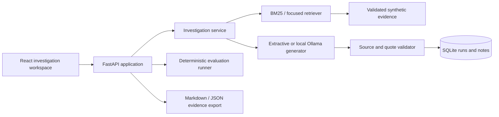

# Architecture and decisions

Domain independent of HTTP. Retrieval, generation and persistence have small injected interfaces because those are actual substitution and test seams. Validation happens after generation. Invalid claims are dropped and disclosed; no supported claims means abstention. Evidence is scoped before ranking.

BM25 is a transparent lexical baseline, suitable for a compact technical corpus. Focused retrieval adds documented incident-context priors, not vector embeddings. Keeping a baseline exposes whether extra policy improves the test set. SQLite fits one local user; no database subscription. React and TypeScript provide a typed interactive UI; Python makes evaluation/retrieval straightforward to inspect. No orchestration framework is needed.

Default extractive engine is not an LLM. Local generation uses installed Ollama on loopback with cloud features disabled. No model gets shell, network, cloud, or remediation tools. Citation checks do not establish entailment. UI/exports disclose those boundaries.

## Operational boundaries

Loopback, synthetic data, single user, bounded inputs, no telemetry or secrets. No production availability or tenant-isolation claim. Cloud architecture is a documented future mapping only, with no infrastructure provisioned.

## Retrieval policy details

Tokenization lowercases alphanumerics and removes a fixed stopword set. Both policies require at least 40% of meaningful query tokens to occur in one trusted source before admitting answer context. This conservative lexical threshold reduces incidental-overlap answers; it can reject valid paraphrases and does not establish semantic relevance. At most five sources are returned. Focused ranking boosts incident service/tag matches by 15% and explicit evidence-kind hints by 25%; priors never admit a zero-overlap source. These choices were developed against the authored scenarios and must be re-evaluated on new data.

## Reference documentation

[Ollama local-only operation](https://docs.ollama.com/faq#how-do-i-disable-ollama-cloud-features), [Ollama structured output API](https://docs.ollama.com/api/generate), [GitHub Actions billing](https://docs.github.com/en/billing/concepts/product-billing/github-actions), and [GitHub budget enforcement](https://docs.github.com/en/billing/concepts/budgets-and-alerts) informed provider boundaries. Local readbacks, not a free-tier assumption, established the configured model and existing zero-dollar budget.
